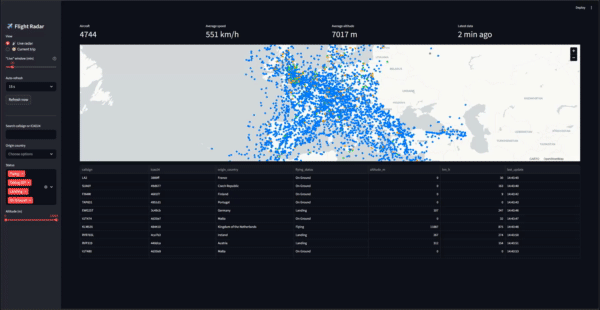
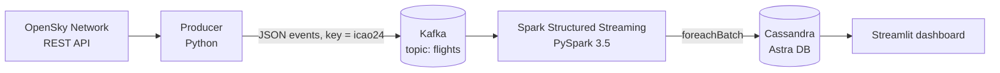

# ✈️ Flight Radar — Real-Time Flight Tracking over Europe

An end-to-end streaming data pipeline that ingests live aircraft positions over Europe, processes them with Spark Structured Streaming, stores them in Cassandra and visualises them in an interactive dashboard with a live radar and per-aircraft trip tracking.

**Stack:** Python · Apache Kafka · Apache Spark (Structured Streaming) · Apache Cassandra (DataStax Astra DB) · Streamlit · Docker Compose



---

## Table of contents

- [Architecture](#architecture)
- [How it works](#how-it-works)
- [Data model](#data-model)
- [Dashboard](#dashboard)
- [Getting started](#getting-started)
- [Project structure](#project-structure)
- [Design decisions](#design-decisions)
- [Limitations and future work](#limitations-and-future-work)

---

## Architecture



Each component runs in its own Docker container and communicates through Kafka, so the ingestion and processing layers are fully decoupled.

## How it works

1. **Producer** (`producer/`)
   Polls the [OpenSky Network](https://opensky-network.org/) API using OAuth2 credentials and keeps only aircraft inside a bounding box covering Europe. Each aircraft becomes one JSON message published to the Kafka topic `flights`, keyed by its `icao24` identifier so every message for the same aircraft lands in the same partition and keeps its order.

2. **Kafka** (`docker-compose.yml`)
   Single-broker cluster running in KRaft mode (no ZooKeeper). It buffers events and decouples the producer from the stream processor. The topic is created with 3 partitions.

3. **Spark Structured Streaming** (`spark/`)
   Reads the topic and parses the messages against an explicit schema. Then it:
   - converts Unix timestamps to proper timestamp types,
   - converts speed from m/s to km/h,
   - derives a `flying_status` (`On Ground`, `Taking Off`, `Landing`, `Flying`) from the on-ground flag, barometric altitude and vertical rate,
   - writes each micro-batch to Cassandra with `foreachBatch` through the Spark Cassandra Connector, splitting the data into a positions table and an aircraft catalogue.

4. **Cassandra / Astra DB**
   Stores the position history and the aircraft catalogue. Writes are upserts, so re-processed events do not create duplicates.

5. **Dashboard** (`dashboard/`)
   A Streamlit app that queries Cassandra and renders the data on a map (see below).

## Data model

Keyspace: `radar_flights`

| Table | Columns | Purpose |
|---|---|---|
| `flights` | `icao24`, `callsign`, `longitude`, `latitude`, `baro_altitude`, `time_position_date`, `last_contact_date`, `flying_status`, `velocity_km_h` | Position history of every aircraft |
| `planes` | `icao24`, `callsign`, `origin_country` | Aircraft catalogue |

<!-- TODO: verify this matches your real tables (DESCRIBE TABLE flights;) -->
Example schema:

```sql
CREATE TABLE radar_flights.flights (
    icao24 text,
    time_position_date timestamp,
    callsign text,
    longitude float,
    latitude float,
    baro_altitude float,
    last_contact_date timestamp,
    flying_status text,
    velocity_km_h float,
    PRIMARY KEY (icao24, time_position_date)
) WITH CLUSTERING ORDER BY (time_position_date DESC);

CREATE TABLE radar_flights.planes (
    icao24 text,
    callsign text,
    origin_country text,
    PRIMARY KEY (icao24, callsign)
);
```

Partitioning by `icao24` makes "give me the history of this aircraft" a single-partition read, which is exactly what the trip view needs.

## Dashboard

Two views, selectable from the sidebar:

**📡 Live radar**
- Map with the latest known position of every aircraft, coloured by flight status.
- KPIs: aircraft count, average speed, average altitude, age of the latest data.
- Hover tooltips with callsign, ICAO24, status, altitude, speed and timestamp.
- Sortable table with the same data.

**🧭 Current trip**
- Pick up to 8 aircraft and see the path of their current trip drawn on the map.
- The current trip is detected automatically: it starts at the last takeoff, or after a long gap without data (configurable).
- Per-aircraft stats: number of points, distance flown, duration, maximum altitude and average speed.
- Altitude profile chart along the trip.

**Filters:** callsign / ICAO24 search, origin country, flight status, altitude range, "live" time window and auto-refresh interval (off / 15 s / 30 s / 60 s).

## Getting started

### Prerequisites

- Docker and Docker Compose
- An [OpenSky Network](https://opensky-network.org/) account with API credentials
- A free [DataStax Astra DB](https://www.datastax.com/products/datastax-astra) database with a keyspace named `radar_flights`

### 1. Configure credentials

Credentials are **not** included in the repository (they are git-ignored).

| File | Content |
|---|---|
| `producer/credentials.json` | OpenSky API credentials, in the format expected by the `opensky_api` `TokenManager` |
| `spark & dashboard/data/secure-connect-radar-flights.zip` | Astra DB *Secure Connect Bundle* |
| `spark & dashboard/data/generated-token.json` | Astra DB application token (`clientId` / `secret`) |

### 2. Create the tables

Run the CQL from the [Data model](#data-model) section in the Astra DB CQL console.

### 3. Start everything

```bash
docker compose up --build
```

Optionally create the topic with 3 partitions before starting the producer (otherwise Kafka auto-creates it with the default of 1):

```bash
docker exec -it kafka /usr/bin/kafka-topics --create --topic flights \
  --bootstrap-server localhost:9092 --partitions 3 --replication-factor 1
```

### 4. Open the dashboard

Go to **http://localhost:8501**. Data appears after the first polling cycle has gone through Kafka and Spark.

### Configuration

| Environment variable | Default | Description |
|---|---|---|
| `ASTRA_DATA_DIR` | `/app/data` | Folder with the bundle and token |
| `ASTRA_BUNDLE` | `<data dir>/secure-connect-radar-flights.zip` | Path to the secure connect bundle |
| `ASTRA_CLIENT_ID` / `ASTRA_CLIENT_SECRET` | read from `generated-token.json` | Override the token file |
| `DASHBOARD_TZ` | `Europe/Madrid` | Time zone used to display timestamps |

## Project structure

```
flight_radar/
├── docker-compose.yml
├── producer/
│   ├── Dockerfile
│   ├── requirements.txt
│   └── producer.py          # OpenSky → Kafka
├── spark/
│   ├── Dockerfile
│   ├── requirements.txt
│   ├── spark_streaming.py   # Kafka → Spark → Cassandra
│   └── data/                # credentials (git-ignored)
└── dashboard/
    ├── Dockerfile
    ├── requirements.txt
    ├── app.py               # Streamlit dashboard
    └── data/                # credentials (git-ignored)
```

## Design decisions

- **Kafka between the API and Spark.** It decouples ingestion from processing: if Spark is down, events are retained and replayed; if the API is slow, the processor is unaffected.
- **Message key = `icao24`.** Guarantees per-aircraft ordering within a partition and enables parallel consumption as the number of partitions grows.
- **Explicit schema in Spark.** Faster and safer than schema inference, and malformed messages become `null` fields instead of breaking the job.
- **Cassandra for storage.** The workload is write-heavy, time-series shaped and always queried by aircraft or time, which fits Cassandra's partitioned, query-first modelling. Inserts with the same primary key overwrite, so the pipeline is idempotent.
- **Polling interval driven by the API quota.** OpenSky charges credits per request according to the size of the queried area. A request covering a large area costs 4 credits, so the producer polls every 400 s (≈ 36 credits/hour, 864/day) to stay within the daily budget. The Europe bounding box is applied on the client side.
- **Cached queries in the dashboard.** Cassandra is not queried on every interaction: results are cached for a short TTL and only the visible fragment auto-refreshes.

## Limitations and future work

- **Update frequency.** Because of the API quota, positions are refreshed roughly every 7 minutes, so the dashboard is "near real time", not second-by-second.
- **Latest-position lookup.** The live radar scans `flights` with a time filter, which is fine for a small table but will not scale. A dedicated `latest_positions` table (primary key `icao24`) maintained by Spark would make it a cheap read.
- **Checkpointing.** The streaming query has no checkpoint location yet; on restart it re-reads the topic from the beginning (safe thanks to idempotent writes, but wasteful).
- **Dropped fields.** Heading (`true_track`), vertical rate and squawk code are discarded in Spark. Keeping them would enable aircraft icons rotated by heading and emergency squawk alerts (7500 / 7600 / 7700).
- **Windowed aggregations.** Traffic per time window and region (with watermarking) would add analytics on top of the raw positions.
- **Testing and CI.** Extract the transformation logic into pure functions, add `pytest` tests and a GitHub Actions workflow.
- **Coverage.** OpenSky relies on volunteer receivers, so coverage is not uniform across regions.

## Data source

Flight data provided by the [OpenSky Network](https://opensky-network.org/). Please review their terms of use and citation requirements before publishing results.

## Author

**Marcos de Castro Muñoz** — [LinkedIn](https://linkedin.com/in/marcos-de-castro-muñoz) · [GitHub](https://github.com/torecsgo)
